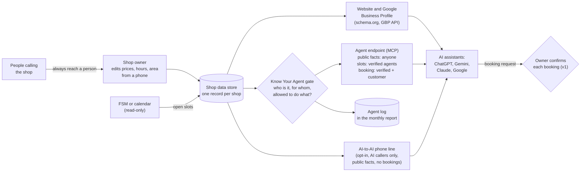

# Cambi Growth Roadmap: Agent-Ready Trades

Last updated Nov 12, 2026 · Yan

The working roadmap for the Cambi Growth pivot, kept in the website repo. It started as the "Cambi Growth Pivot: Agent-Ready Trades, Phased Plan" doc and now also carries the pricing plans, the website rebuild and the voice decision.

### Changes from the original plan

| Area | Was | Now |
| --- | --- | --- |
| Pricing | Placeholder packages in Phase 3 ($1,500-2,500 setup, $250-400/mo) | Three tiers, each with a pay-up-front or $0-down option, priced 50% above the first draft (see Pricing plans) |
| Voice | Inbound voice fallback for Google's caller and humans, after hours and overflow | AI-to-AI line only: answers calls placed by AI assistants, never people; opt-in add-on, never a headline feature |
| Partners | Fixed packages | Plans built to evolve with each shop: upgrade credit, new AI channels as they launch, founding partner terms, a partner council |
| Website | "Add a trades landing page as a test" | Whole site rebuilt around the pivot (Next.js); runs locally, not deployed yet (see Website) |
| Know Your Agent | "Treat every agent request as untrusted input" (one Phase 4 design rule) | KYA is part of the product: Cambi decides which AI agents may read, check availability or request a booking for a shop, and logs every one (see Know Your Agent) |

## Executive summary

Cambi Growth pivots from general web development to making NYC trade shops (HVAC, plumbing, electrical) readable and bookable by AI agents. It starts as a done-for-you service, and software is built only after paid pilots prove the problem and the willingness to pay.

**Thesis.** Personal agents (Muse, ChatGPT, Claude, Gemini) increasingly do the finding and booking. Most trade shops publish no prices, have no online booking, and can only be reached by a human on the phone, so agents fail at the price step and hand the job back to the user. Google's calling agent already hits this wall: in plumbing, 26% of its calls go unanswered, and 48% of answered calls give no price.

**What Cambi sells.** One source of truth per shop (price ranges, service area, hours, capacity, booking), exposed three ways:

1. Machine-readable web and Google Business Profile data, so agents can discover the shop
2. An agent endpoint (MCP/API), so agents can quote and book directly
3. An opt-in AI-to-AI phone line reading the same data, for AI assistants that phone the shop (Google's AI calling first). It never answers people: every human caller reaches the shop as today.

Behind all three sits **Know Your Agent (KYA)**: before an AI agent gets more than public prices, Cambi checks who the agent is, who it acts for and what it may do, and keeps a log the owner can see. Agents get the shop's data; the shop knows who is asking.

**What Cambi does not do.** No consumer marketplace (Angi, Thumbtack and Google own demand). No outbound AI calling (TCPA consent exposure). No AI voice answering people. No custom software before 10 paying shops.

**Phases and gates.**

```mermaid
gantt
    title Phases and gates (start Mon 16 Nov 2026)
    dateFormat YYYY-MM-DD
    axisFormat %b %Y
    section Phase 0
    Foundations: LLC, insurance, rubric        :p0, 2026-11-16, 3w
    Gate 0: LLC filed, rubric reliable          :milestone, g0, 2026-12-07, 0d
    section Phase 1
    Problem validation: audits, interviews      :p1, 2026-11-30, 6w
    Gate 1: H1-H3 pass                          :milestone, g1, 2027-01-04, 0d
    section Phase 2
    Concierge pilots, 3 to 5 shops              :p2, 2027-01-04, 8w
    Gate 2: KEY DECISION, continue alongside a 2027 job? :crit, milestone, g2, 2027-03-01, 0d
    section Phase 3
    Productized service and rollout             :p3, 2027-03-01, 16w
    Gate 3: 10+ paying shops                    :milestone, g3, 2027-06-21, 0d
    section Phase 4
    Platform build (only after Gate 3)          :p4, 2027-06-21, 12w
```

| Phase | Weeks | Dates | Gate to pass before moving on |
| --- | --- | --- | --- |
| 0. Foundations | 1-3 | 16 Nov to 6 Dec 2026 | LLC filed, insurance quoted, rubric scored consistently by two people |
| 1. Problem validation | 3-8 | 30 Nov 2026 to 3 Jan 2027 | H1, H2, H3 pass; 5+ owners agree to a second meeting |
| 2. Concierge pilots | 8-16 | 4 Jan to 28 Feb 2027 | 3+ paid pilots, measurable lift, **decision on running Cambi alongside a 2027 role** |
| 3. Productized service | 16-32 | Mar to Jun 2027 | 10+ paying shops, churn under 5%, delivery under 6 hours |
| 4. Platform build | 32+ | From late Jun 2027 | Software margins; a second city works without Yan on site |

The gate after Phase 2 is the key decision: whether Cambi continues alongside a 2027 full-time role.

**Capacity constraint.** Yan is a full-time master's student until May 2027 and recruiting for 2027 roles. The plan assumes 10-15 hours per week and treats affordable loss (time and money) as a hard limit, not a target.

## Method: frameworks and how each is used

Every phase runs as a hypothesis test with a written pass/kill threshold set before data comes in. The frameworks below are standard in entrepreneurship programs (Stern, MIT, Stanford); each is assigned a specific job here so none is decoration.

| Framework | Source | Job in this plan |
| --- | --- | --- |
| Customer Development | Steve Blank, *The Four Steps to the Epiphany* | Phase structure: discovery (Ph 1), validation (Ph 2), creation (Ph 3), company building (Ph 4). Get out of the building before building. |
| Lean Startup | Eric Ries | Build-measure-learn loops; concierge and Wizard-of-Oz MVPs; pivot or persevere decision at each gate; innovation accounting (metrics in the last section). |
| The Mom Test | Rob Fitzpatrick | Interview rules: ask about past behavior and money already spent, never "would you use this?". Compliments and hypotheticals count as zero evidence. |
| Effectuation | Saras Sarasvathy | Start from means you have (Cambi, web skills, NYC, NYU network). Affordable loss sets the budget. Pre-commitments from pilot shops shape the product. |
| Disciplined Entrepreneurship | Bill Aulet, MIT | Beachhead market, end-user persona, TAM bottom-up, decision-making unit, cost of customer acquisition (COCA) vs lifetime value (LTV). |
| Jobs to Be Done | Clayton Christensen | Frame the job: "when a customer or their agent asks for a price, I want the job captured without me picking up." Competes against voicemail, a nephew who does the website, and Angi leads. |
| Value Proposition Canvas | Alex Osterwalder | Map owner pains and gains to each package feature in Phase 2. |
| Pretotyping, XYZ hypothesis | Alberto Savoia, *The Right It* | Phrase every hypothesis as "at least X% of Y will do Z" and test with real skin in the game (money, time, data access). |
| Blue Ocean ERRC + new combinations | Kim & Mauborgne; Schumpeter | Positioning against Angi, AI receptionists and FSM vendors: combine existing parts (web, schema, FSM APIs, voice AI, MCP) into an offer no single incumbent sells to small shops. |

**Evidence hierarchy** (strongest first): money paid > signed letter of intent or deposit > granted data access (GBP manager, FSM login) > time committed (second meeting) > specific past-behavior story > stated interest. Gates count only the top four.

## Hypotheses and evidence register

The riskiest assumption is not the gap (already visible) but whether small-shop owners will pay to close it and publish price ranges. Hypotheses are ordered by risk; each threshold is fixed now so later data cannot be rationalized.

| ID | Hypothesis (XYZ form) | Data to collect | Method | Pass | Kill or pivot |
| --- | --- | --- | --- | --- | --- |
| H1 | At least 60% of NYC 1-10 truck trade shops fail an agent-readiness audit (no prices, no online booking, or wrong hours) | Audit score per shop, 100+ shops | Desk audit (Phase 1) | 60%+ fail | Under 30% fail: gap is closing on its own, stop |
| H2 | At least 50% of owners interviewed describe losing jobs to missed or unanswered calls in the last 90 days, with a number | Specific story + estimated lost jobs | Mom Test interviews, 15+ | 50%+ with a number | Under 25%: pain is not felt, reposition to marketing |
| H3 | At least 40% of owners will publish price ranges for 5+ common jobs | Willingness + actual publish | Ask in interview, then in pilot | 40% say yes, 2 of 3 pilots publish | Under 20%: drop public price book; quote by tier or diagnostic fee only |
| H4 | At least 3 of 10 pitched owners sign the founding-partner offer (6-month minimum) and pay the first discounted monthly within 30 days | Signed agreements, first payments | Concierge offer (Phase 2) | 3+ signed and paid | 0-1 paid after 20 pitches: price or offer is wrong, rework |
| H5 | Agent-ready shops get measurably more inbound jobs within 60 days | Calls, form fills, bookings, AI-call outcomes before vs after | Pilot baseline then after | +15% booked jobs or AI-call answer rate over 90% | No lift: value is unproven, do not scale |
| H6 | Delivery takes under 6 hours per shop after the 5th shop | Time log per shop | Phase 2-3 tracking | Under 6 hrs | Over 12 hrs: not productizable at target price |
| H7 | Shops retain on a monthly plan | Monthly churn | Phase 3 | Under 5%/month | Over 10%/month: sell one-time setup only |
| H8 | Consumer agents read and use structured shop data (schema, GBP, MCP) | Test queries in ChatGPT, Gemini, Claude, Muse before vs after | Controlled test per pilot shop | Agent quotes or books correctly in 2+ assistants | Agents ignore it: lean on GBP and the AI-to-AI line, skip MCP |
| H9 | An AI-to-AI line can tell AI callers from people without making people wait or press anything | Share of Google AI calls answered with a price; any human caller routed to the line by mistake | Test line with Google's AI calling in Phase 2 | 90%+ of AI calls get a price, 0 people misrouted | Any person misrouted: drop the voice line and rely on published data only |

**Data hygiene.** One spreadsheet tab per hypothesis, raw rows only, date-stamped. Interview notes written within 24 hours. No hypothesis is marked passed on stated interest alone.

## Phase 0: foundations and pivoting existing Cambi infrastructure (weeks 1-3)

Phase 0 reuses what Cambi already has and adds only the legal and tooling minimum. Existing clients stay served: they are revenue, references, and test beds.

**Asset-by-asset pivot.**

| Existing Cambi asset | Pivoted role | Action |
| --- | --- | --- |
| 3 current clients (incl. Vital Care) | Revenue base and first agent-readiness test beds, even though not trades | Keep serving. Offer each a free readiness upgrade (schema, GBP cleanup) to rehearse the delivery checklist and capture before/after data |
| Client-site monitoring dashboard (being fixed) | Becomes the **Agent Readiness Monitor**: uptime plus readiness score, GBP hours drift, schema validity, test-query results per shop | Finish the fix with readiness checks as new columns rather than a rebuild |
| Web build skills and templates | Trade-site template with structured price ranges, service area, booking, schema.org markup | Build one template in Phase 2 from the first pilot, not before |
| Brand "Cambi Growth" | Parent brand. Positioning line: "Get booked by AI, not just found" | Do not rename until Phase 3 pass. Done ahead of plan: the whole site is rebuilt around the pivot (see Website) |
| Lead gen priority | Redirected to trades: audit-first outbound | See Pitch playbook |
| Pending LLC vs sole proprietor decision | Resolve now: LLC | You will hold owners' Google Business Profile access, booking data and possibly call recordings. Liability separation matters more than before |

**Legal and admin minimum** (confirm with an accountant or attorney; this is not legal advice):

- [ ] Form a NY LLC (NY also requires the LLC publication step within 120 days; budget for it, cost varies by county)
- [ ] EIN, business bank account, simple bookkeeping
- [ ] Insurance: E&O / professional liability plus cyber liability (you will handle client data and accounts)
- [ ] Standard client agreement: scope, data access, who owns the price book and data (the shop does), cancellation, liability cap
- [ ] Data processing terms: what you store, retention, revocation of access on exit
- [ ] Access hygiene: password manager, GBP "manager" (not owner) roles, per-client credentials, 2FA

**Tooling minimum.**

- [ ] Audit rubric v1 (below) in a spreadsheet
- [ ] CRM: a simple sheet or free CRM with pipeline stages (audited, contacted, interviewed, pitched, pilot, paid)
- [ ] Interview script and notes template (Mom Test)
- [ ] Call log template for AI-call tests

**Agent Readiness Score v1 (0-100).** The audit, the pitch hook and the monitor all use this one rubric.

| Dimension | Points | Check |
| --- | --- | --- |
| Google Business Profile complete and accurate (hours, services, area, categories) | 20 | GBP vs site vs phone answer |
| Prices or ranges published for common jobs | 20 | Site and GBP services |
| Online booking or request form with real availability | 15 | Site |
| Structured data (schema.org LocalBusiness, Service, Offer, areaServed, hours) | 10 | Schema validator |
| Phone answered within business hours | 15 | Test call |
| Gives a price or range on the phone | 10 | Test call |
| Licensing and insurance visible and verifiable | 10 | Site plus NYC DOB license lookup |

Gate to Phase 1: LLC filed, insurance quoted, rubric scored on 5 test shops by two people with under 10 points difference (checks the rubric is reliable).

## Phase 1: problem validation (weeks 3-8)

Phase 1 tests H1, H2 and H3 with four workstreams and produces one deliverable: a short memo with the audit data, interview findings and a go/no-go against the thresholds.

### A. Desk audit (H1)

- **Sample.** 100-150 shops, stratified: 3 trades (HVAC, plumbing, electrical) by 5 boroughs, plus a small Westchester/NJ control. Pull from Google Maps searches ("plumber near \[neighborhood\]") and cross-check against NYC DOB licensed master plumber and electrician lists on NYC Open Data.
- **Tag each shop** by size (1-3, 4-10, 10+ trucks, estimated from reviews and fleet photos) and FSM in use (booking widgets often reveal ServiceTitan, Jobber, Housecall Pro).
- **Score** with the Agent Readiness rubric. Two scorers on a 10% subsample to check consistency.

### B. Agent tests (H1, H8)

For 30 audited shops, ask the same scripted job ("water heater not heating, Upper West Side, this week, price?") through Muse, ChatGPT, Claude and Gemini. Log: found the shop, gave a price, gave availability, completed booking, handed back to the user.

For 20 shops, also use Google's "have AI check prices" feature as a normal consumer would and log what Google reports back. Google places the call, not you.

Ethics: do not invent fake emergencies or book jobs you will cancel. Use real household needs (yours, friends', family's) or ask openly for a price comparison. Wasting a small shop's dispatcher time damages the reputation you are about to sell to.

### C. Owner interviews (H2, H3)

15-20 owners or office managers, 20-30 minutes, in person where possible. Recruit through supply houses (counter staff know every owner), trade association meetings, local business improvement districts, and warm intros from audited shops. Offer the free audit as the thank-you, not a pitch.

Mom Test questions (past behavior, not opinions):

1. Walk me through the last time a call came in that you couldn't take. What happened to that job?
2. How many calls a week go to voicemail? How do you know?
3. Has anyone called you lately who sounded like a robot or said they were calling for a customer? What did you tell them?
4. When someone asks "how much" on the phone, what do you say? Why?
5. What do you pay today to get jobs (Angi, Thumbtack, LSAs, Yelp, SEO guy)? What did you get for it last month?
6. What software runs your schedule? Who set it up? What do you hate about it?
7. Who decides on spending like this, and who else would need to agree?

Never ask "would you pay for X?". Close with: "Can I send you your audit score? Could I check back in two weeks?" (a time commitment counts as evidence).

### D. Market sizing (bottom-up, Aulet)

- **Pull** Census County Business Patterns for NAICS 238220 (plumbing, heating, AC) and 238210 (electrical) for the five NYC counties, by employee-size class. Secondary sources put New York State at about 7,300 plumbing/HVAC and 5,700 electrical establishments (2024); verify against the Census table before using.
- **Beachhead** = NYC establishments with 1-9 employees, residential service (not new construction).
- **Unit economics model** (assumptions to test, not facts): setup fee $1,500, retainer $300/month, 24-month average life, gross margin 70% → LTV about $6,100. COCA must stay under one third of LTV, about $2,000 per shop, including your time at a stated hourly rate.

### Phase 1 gate

| Check | Threshold |
| --- | --- |
| Shops audited | 100+ |
| Share failing audit (H1) | 60%+ |
| Owners interviewed | 15+ |
| Owners with a specific lost-job story and number (H2) | 50%+ |
| Owners open to publishing price ranges (H3) | 40%+ |
| Owners agreeing to a second meeting | 5+ |

Pass all: go to Phase 2. Fail H2 or H3: pivot the offer (e.g. sell inbound call capture first, price book later) and retest with 10 more interviews before spending on pilots.

## Phase 2: solution validation through concierge pilots (weeks 8-16)

Phase 2 delivers the full outcome by hand for 3-5 shops, using off-the-shelf tools, to test H4, H5, H6 and H8. Nothing is coded that a person or an existing tool can do.

### Pilot selection

Pick from Phase 1 interviewees who scored under 50, told a lost-job story, agreed to publish some prices, and run 1-10 trucks. Mix trades (at least one plumber and one HVAC shop). Avoid friends and family as the majority: their results will not convince strangers.

### Pilot terms

- The founding-partner offer (see Pricing plans): setup waived, 50% off the tier's monthly for the first 6 months, a 6-month minimum, then the full monthly with the founding rate locked for 24 months. Measurement runs over the first 90 days. The shop pays from month one: payment is the evidence for H4, and a free pilot proves nothing.
- No pay-per-lead pricing, even to start: it contradicts "we are not a lead seller", and AI-sourced calls cannot be attributed fairly without tracking numbers, which the plan rules out.
- In exchange: GBP manager access, read access to their schedule or FSM, permission to measure and to publish an anonymized or named case study.
- Written scope, success metrics, and an exit: they keep everything built, you remove your access.

### Baseline (weeks 8-10)

Measure 2-4 weeks before changing anything: GBP insights (calls, website clicks, booking clicks), jobs booked per week from the owner's records, missed-call count (from phone carrier log or FSM), readiness score, and the agent test results.

Do not swap their main phone number for a tracking number: it breaks name/address/phone consistency across listings, which hurts local ranking. Use FSM or carrier call logs instead.

### Delivery (concierge, per shop)

1. **Price book workshop (90 min).** Top 10-15 jobs by volume, each as a range with what drives the low and high end, plus diagnostic and emergency fees. Owner approves every number in writing.
2. **Google Business Profile.** Correct hours, service area, categories, services with prices, booking link, photos.
3. **Website page.** Services and price ranges in plain text plus schema.org markup (LocalBusiness / Plumber / HVACBusiness, Service, Offer with PriceSpecification, areaServed, OpeningHoursSpecification). Validate with Google's Rich Results test.
4. **Booking.** Use their FSM's online booking if they have one; otherwise a request form with a 15-minute confirm promise (Wizard of Oz: a human confirms behind it).
5. **AI-to-AI line (opt-in, test only).** Only for pilots that agree to test it: configure an existing AI answering vendor with the price book so that calls placed by AI assistants (Google's AI calling first) get prices, hours and open slots. It never answers a person; every human call reaches the shop as today. Test H9 before offering it to anyone else.
6. **Agent tests.** Re-run the Phase 1 scripted queries in Muse, ChatGPT, Claude, Gemini and Google's AI calling; log changes.
7. **Time log.** Every hour spent, by task (H6).

### What you learn, not just what you deliver

After each pilot, fill a Value Proposition Canvas: which pains the owner mentioned unprompted, which features they used, which they ignored. Features nobody uses are cut before Phase 3 packaging.

### Phase 2 gate

| Check | Threshold |
| --- | --- |
| Pilots live | 3+ |
| Pilots signed and paying the discounted monthly (H4) | 3+ |
| Measurable lift: +15% booked jobs, or AI calls answered with a price 90%+ (H5) | 2+ shops |
| AI-to-AI line misroutes no person (H9, only if tested) | 0 misrouted |
| Agents quote correctly in 2+ assistants (H8) | 2+ shops |
| Pilots converting to monthly plan | 2+ |
| Hours per shop, trend | Falling toward 6 |

If lift is unclear after 90 days, extend one pilot 30 days rather than declaring success. Small samples are noisy; report ranges, not single numbers.

## Phase 3: productized service and rollout (weeks 16-32)

Phase 3 turns the pilot checklist into fixed packages with fixed prices and written procedures, so delivery no longer depends on Yan's judgment for each shop.

### Packages

The free Agent Readiness Audit stays the lead magnet and pitch opener (score, 1-page report, Google AI-call result, top 3 fixes). The paid packages are the three tiers in **Pricing plans** below, each with a pay-up-front or $0-down option; they replace the first draft's setup-plus-monthly placeholders ($1,500-2,500 setup, $250-400/month). Prices stay hypotheses until Phase 2 data confirms them.

Pricing method: anchor against what owners already pay per job from Angi, Thumbtack or Local Services Ads (collected in Phase 1 interviews). The setup should pay back within a few extra booked jobs; check that against real ticket sizes from the interviews. Test two price points across the first 10 sales and keep the one with the better close rate times price.

### Operations

- Standard operating procedure per delivery step, with screenshots, written from the pilot time logs.
- Templates: price book sheet per trade, schema snippets, GBP checklist, monthly report.
- The Agent Readiness Monitor (the pivoted dashboard) runs weekly checks for every client.
- Capacity math: at 10-15 hours per week, 6 hours per setup and about 1 hour per client per month, Yan can add 2-3 shops a month while maintaining about 15. Beyond that, hire a part-time contractor (an NYU student works well) and train them on the procedures before adding more clients.

### Rollout sequence

1. **One dense cluster first.** One trade-heavy area (e.g. a Queens or Brooklyn corridor with many shops and one supply house). Density makes referrals and in-person visits cheap.
2. **Case studies.** Two named pilot results with before/after numbers.
3. **Channel partners.** Supply house counters, trade associations, and the bookkeepers or insurance brokers who serve trades. Offer a referral fee or free audits for their members.
4. **Referral loop.** One free month for the referring shop per signed shop.
5. **Expand by trade, then borough.** Add the second trade or borough only when the first one's close rate is stable.

### Phase 3 gate

| Check | Threshold |
| --- | --- |
| Paying shops | 10+ |
| Monthly churn (H7) | Under 5% |
| Delivery hours per shop (H6) | Under 6 |
| COCA vs LTV | COCA under one third of LTV |
| One workflow repeated identically across clients | Identified and documented |

## Pricing plans: tiers and payment options

Three tiers, each paid one of two ways: pay the setup up front for the lowest monthly, or start at $0 down with a higher monthly for the first 12 months, after which it drops to the standard rate. This replaces the placeholder package table in Phase 3. Every price here is a hypothesis to validate in Phase 2 (H4), not a final number.

| Tier | Fits | Pay up front | $0 down |
| --- | --- | --- | --- |
| Agent-Ready Starter | 1 to 3 trucks, prices given on the phone today | $2,250 setup + $375/mo | $600/mo for 12 months, then $375/mo |
| Agent-Ready Booked (expected most chosen) | 4 to 10 trucks, runs Jobber, Housecall Pro, ServiceTitan or a shared calendar | $3,750 setup + $600/mo | $940/mo for 12 months, then $600/mo |
| Growth Partner | Multi-crew shops that want to be first on every new AI channel | $6,000 setup + $1,125/mo | $1,650/mo for 12 months, then $1,125/mo |

**What each tier includes**

| Included | Starter | Booked | Growth Partner |
| --- | --- | --- | --- |
| Free audit plus before and after assistant tests | Yes | Yes | Yes |
| Price book (ranges, owner approves every number) | Top 10 jobs | Top 20 jobs, diagnostic and emergency fees | Full price book, every trade the shop runs |
| Google Business Profile cleanup | Yes | Yes | Yes |
| Website | New website, up to 6 pages, with hosting (or AI-readable pages added to the shop's own site) | Same, plus a page per service and per borough | Same as Booked |
| MCP connection for AI assistants | Read-only: prices, hours, area | Plus booking requests from verified agents | Same as Booked |
| Services pages AI can read (schema.org) | One services page | A page per service and per borough | Same as Booked |
| Booking | Request form, owner confirms within 15 minutes | Live open slots from the shop's FSM or calendar | Live open slots, owner confirms each booking |
| Monitoring and report | Monthly checks, monthly report | Weekly checks, monthly report | Weekly checks, monthly report, quarterly strategy review |
| Price updates | Up to 2 a month | Unlimited | Unlimited |
| AI-to-AI phone line: answers calls placed by AI assistants only, never people | Add-on | Add-on | Optional add-on, off by default |
| New AI channels as they launch (agent endpoint, new assistants) | Add-on when available | Included at a standard setup fee | Included first, no setup fee |
| Know Your Agent: which AI agents asked, verified or not, and what they did | Monthly agent log in the report | Agent log, plus only verified agents can request bookings | Agent log, verified-only booking, and the shop's own allow and block rules per agent |
| Partner council: quarterly roadmap call | No | No | Yes |

**How the two payment options work**

- **Pay up front:** the setup fee once, then the standard monthly. Month to month after the first 3 months.
- **$0 down:** no setup fee; the setup is spread across a 12-month term at a higher monthly. After month 12 the monthly drops to the standard rate and runs month to month. Over the first year this costs $450 more than paying up front on Starter, $330 more on Booked and $300 more on Growth Partner, which is the cost of spreading the setup.
- **Switching:** a $0 down shop can pay off the rest of its setup at any time and move to the standard monthly from the next bill.

**Evolving with partners.** AI booking is new, and the channels will keep changing, so the plans are built to grow with each shop rather than lock it into one package.

- **Upgrade credit:** setup already paid counts in full toward the next tier's setup.
- **New channels:** as assistants add direct booking and agent standards (MCP and others) settle, Growth Partners get each new channel first with no setup fee; Booked shops get it at a standard setup fee; Starter shops can add it.
- **Founding partners (first 10 shops):** setup waived, 50% off the monthly for the first 6 months, a 6-month minimum, then the full monthly with the founding rate locked for 24 months. In return the shop gives monthly feedback, the data access the pilot needs, and a case study if it agrees to one.

  | Founding offer | Starter | Booked | Growth Partner |
  | --- | --- | --- | --- |
  | Setup | Waived | Waived | Waived |
  | Months 1 to 6 | $187.50/mo | $300/mo | $562.50/mo |
  | From month 7 (locked 24 months) | $375/mo | $600/mo | $1,125/mo |

  Waiving setup for 10 shops forgoes $22,500 to $60,000 at list price that early adopters were unlikely to pay anyway; the discounted monthlies still cover delivery time. Pay-per-lead was considered and rejected (see Phase 2, Pilot terms).
- **Price changes:** rates are reviewed once a year, with 60 days' notice to existing shops. Founding rates are not affected during their lock.

**Add-ons**

| Add-on | Available on | Price |
| --- | --- | --- |
| AI-to-AI phone line | All tiers | $450 setup + $225/mo, 150 minutes included, extra minutes at vendor cost plus 20% |
| Extra AI-to-AI minutes | Shops with the AI-to-AI line | Vendor cost plus 20% above the 150 included |
| Second trade or location | All tiers | $150/mo |

No automated texting or outbound calling is offered as an add-on, in line with the TCPA position in the risk register.

**People talk to people; AI talks to AI.** Customers calling a trade shop want a person, and many dislike an AI voice, so voice is never a headline feature and never answers a person. The only voice piece is an opt-in AI-to-AI line: when an AI assistant phones the shop for a customer (Google's AI calling to check prices is the first case), it gets the shop's price ranges, hours and open slots from the price book. Every call from a person reaches the shop exactly as it does today. The pitch leads with prices, hours and open slots that AI assistants can read, not with a robot on the phone.

**Unit economics check** (pay up front, 24-month life, 70% gross margin, as in Phase 1's model)

| Tier | 24-month revenue | LTV | COCA ceiling (one third of LTV) |
| --- | --- | --- | --- |
| Starter | $11,250 | $7,875 | $2,625 |
| Booked | $18,150 | $12,705 | $4,235 |
| Growth Partner | $33,000 | $23,100 | $7,700 |

Phase 1's base case ($1,500 setup, $300/mo, LTV about $6,100) now sits below Starter, so these prices leave more room for the cost of winning each shop. The AI-to-AI line is an add-on, so its vendor costs come out of the add-on price, not out of these margins.

**How to test the prices**

- Test two Starter setup prices ($2,250 and $2,850) across the first 10 sales, and keep the one with the better close rate times price.
- Track the share of shops that choose $0 down. Above 70% means the setup price itself is the barrier; below 20% means owners would pay up front and the $0 down premium can rise.
- Use the Phase 1 interview question on what owners pay Angi, Thumbtack or Local Services Ads per job as the anchor when pitching.

**Decisions still open**

- [ ] 12-month term on $0 down (recommended, since the setup is spread across it) or the old 6-month minimum
- [ ] How the AI-to-AI line tells an AI caller from a person without making people wait or press anything (test with Google's AI calling in Phase 2 before selling it)
- [x] Starter stays at $2,250 setup + $375/mo (decided Nov 13): a small-business website alone often costs that much, and Starter adds the price book, Google profile work and monitoring. Revisit only if Booked becomes the natural entry once FSM connections are routine.
- [x] Phase 2 pilot price: replaced by the founding-partner offer (setup waived, 50% off monthlies for 6 months, 6-month minimum), decided Nov 13

## Know Your Agent (KYA)

Know Your Agent is to AI agents what Know Your Customer is to people: verify **who the agent is, who it acts for, what it is allowed to do**, and keep an audit trail. Cambi sits between a shop and every AI agent that wants its prices, slots or a booking, so KYA is not a side feature; it is the trust half of the product. Owners will let agents book only if they know which agents are booking and can stop the bad ones.

**Where the standards are (Nov 2026).** There is no single formal KYA standard yet; it is an emerging idea modeled on KYC, with competing approaches:

- **Web Bot Auth (Cloudflare):** an agent signs each HTTP request with a public key (HTTP Message Signatures, RFC 9421), and publishes its keys in a well-known directory so a site can verify it. This replaces guessing from user agent and IP address, which can be spoofed. ([Cloudflare, Oct 2025](https://blog.cloudflare.com/secure-agentic-commerce/))
- **Visa Trusted Agent Protocol and Mastercard Agent Pay** both use Web Bot Auth as their agent identity layer: agents register, publish keys, and tag each request as browsing or paying, with a nonce against replays; the networks can link the agent to the consumer it acts for. ([Cloudflare](https://blog.cloudflare.com/secure-agentic-commerce/))
- **AgentFacts:** an open (Apache 2.0) proposal for verifiable agent metadata signed by several authorities; a single-author research paper, not an adopted standard. ([arXiv 2506.13794](https://arxiv.org/abs/2506.13794))
- **Vendors** sell KYA as a service (Skyfire, Vouched and others), each with its own verification levels. ([Vouched](https://www.vouched.id/learn/blog/kya-identity-guide))

So Cambi stays **standard-neutral**: verify with whatever signals an agent offers, start with Web Bot Auth because payment networks already use it, and track the rest quarterly.

**Trust levels for a shop's data**

| Agent | Can do | Why |
| --- | --- | --- |
| Any agent, unverified | Read public facts: price ranges, hours, service area, licenses | Already public on the website and Google profile |
| Verified agent (signed request, known key directory) | Check open slots | Slots reveal a shop's workload; share them only with agents that can be held to account |
| Verified agent acting for an identified customer | Request a booking | A booking costs the shop a truck roll; it needs a known agent and a real customer behind it |
| Any agent, any level | Never confirm a booking or get a final price | The owner confirms every booking in v1; agents get ranges plus a diagnostic fee |

**The phone is the hard case.** A call has no signatures, so the AI-to-AI line gives only public facts (prices, hours, area) and never takes a booking; a caller that wants to book is pointed to the verified web or agent endpoint. This keeps H9's risk small: even a misjudged caller only hears what is already published.

**What each phase does about KYA**

- **Phase 1:** in the agent tests, log whether each assistant identifies itself (user agent, signatures) when it reads or calls a shop. This is the baseline for how verifiable agents are today.
- **Phase 2:** every pilot gets an agent log in its monthly report: which agents came, verified or not, and what they asked. Watch for fake or abandoned booking requests.
- **Phase 3:** agent log in every tier; verified-only booking from Booked up; Growth Partners set their own allow and block rules per agent (see Pricing plans).
- **Phase 4:** the agent endpoint verifies Web Bot Auth signatures before slots or bookings, records the agent, the customer it acts for and the outcome in a tamper-evident log, and adds other standards as they settle.

**Why it helps the business.** It answers the owner's first worry ("who is booking my trucks?"), gives the monthly report something no website builder shows, and is hard for marketplaces to copy because they want the customer, not the shop's control. It goes in the second conversation, never above the fold: owners buy booked jobs, and KYA is why they can trust them.

## Website

The site is the demo: it has to be as readable by AI assistants as the shops it sells to. Rebuilt in November 2026 on the `redesign` branch; the live site (getcambi.com, from `main`) is unchanged until the rebuild is merged.

**Status:** built and reviewed locally (http://localhost:3000 via `npm run build` then `npm start`). Not deployed: the Netlify branch preview has not built yet, and nothing is pushed or merged without Yan's go-ahead.

**What it is**

| Part | Choice |
| --- | --- |
| Stack | Next.js 16 App Router, React 19, TypeScript; hosted on Netlify (paid plan) |
| Design | DESIGN.md in the repo: logo greens and amber, a blueprint and mass-timber direction, Onest type, glass on the nav and package cards only |
| Design process | Taste Skill for the look and its finish gate; Vercel web-interface guidelines for accessibility and forms; Hallmark and Claude SEO as audits only |
| Hero | A 3D mass-timber duplex (react-three-fiber) that assembles on its blueprint plan: structure falls into place storey by storey, HVAC, plumbing and electrical go in before each deck closes, windows slide in from the sides, lights come on; stops within 5 seconds, with a replay button; a still image on phones, slow devices and reduced motion |
| Pages | Home, free audit (form plus sample report), packages, case studies (honest empty state), about, contact, web design work, privacy |
| Main action | "Get my free audit": a server-side form with validation, a bot trap and a rate limit, sending to Netlify Forms |
| Machine-readable | JSON-LD for the business, each package and the FAQ; /llms.txt; sitemap; robots; share image; all prices in plain HTML |

**Checks so far:** form tested end to end (9 of 9 pass); no broken links; accessibility, best practices and SEO 96-100 in Lighthouse; performance 79-88 on mobile measured on a slow laptop, to be re-measured on the Netlify preview against the 95 target. The 3D hero costs about 23 desktop points and none on mobile.

**Still to do on the site**

- [x] Put the tier prices and the up-front / $0-down switch on /packages and the home page (done Nov 13; Starter now lists website building and a read-only MCP connection)
- [x] Reword the voice package and the "Will a robot answer my phone?" answer to the AI-to-AI position (done Nov 13; the FAQ also gained "Who are these AI agents booking my jobs?" for KYA)
- [x] Case studies: dated, sourced evidence that AI calling and booking are rising, and a "Volunteer your shop" form (Netlify form `case-study-volunteer`) offering founding-partner terms (done Nov 13)
- [ ] Keep the case-study evidence current: add a line only from a source that has been opened and read (src/lib/evidence.ts)
- [ ] Get the Netlify branch preview building, then run the Claude SEO audits, the Rich Results test and PageSpeed Insights on it
- [ ] Approve the privacy page's 30-day deletion promise and the case studies' "90-day pilot" wording
- [ ] Supply a portrait of Yan, an SVG logo if one exists, and the Umami analytics ID
- [ ] Turn on email notifications for Netlify form submissions
- [ ] Merge to `main` only when ready to replace the live site

## Phase 4: platform build (week 32 onward, only after the Phase 3 gate)

Phase 4 builds software only for the steps that repeated in every Phase 3 delivery, starting with one shop data store that feeds every channel. Building earlier risks a polished product for a problem shape you guessed.



Every channel reads the same record, so a price change made once reaches the web, agents and the AI-to-AI line together; a human still confirms each booking in v1, and people who call always reach a person.

### Build order

1. **Shop data store.** Price book, service area, hours, licenses, capacity. One record per shop, owner-editable from a phone.
2. **Publishers.** Generates schema.org markup and the services page; syncs GBP through the Business Profile API; keeps them consistent automatically.
3. **Capacity sync.** Read-only connection to FSM schedules (Jobber, Housecall Pro, ServiceTitan APIs where the shop's plan allows) or Google Calendar for shops without FSM.
4. **Agent endpoint.** Pulled forward in part (decided Nov 13): every tier from Starter up includes a **read-only** MCP connection (get\_services, get\_price\_range) from Phase 2, since public facts carry little risk; booking over MCP (Booked and up) stays here, behind the KYA gate. The full build: a multi-tenant remote MCP server where each shop is addressable: get\_services, get\_price\_range, check\_availability, request\_booking. KYA gate in front of it (see Know Your Agent): public facts for any agent, check\_availability for verified agents, request\_booking for verified agents acting for an identified customer. Booking writes a request to the FSM or texts the owner to confirm; nothing is final without a human yes in v1.
5. **Discovery.** Publish the endpoint where agents look: links from the shop's site and GBP, a /.well-known manifest, MCP registry listing. Standards here are still forming; track them quarterly rather than betting on one.
6. **AI-to-AI line (only if H9 passed).** Keep buying the voice layer from a vendor; point it at the same data store, and keep it answering AI callers only.
7. **Monitor.** The Agent Readiness Monitor becomes the client-facing dashboard and the retention tool.

### Design rules

- The shop owns its data and can export it in one click. This is both an ethics point and a sales point against marketplaces.
- Agents get facts and request slots; they never get a final price for a job that needs diagnosis. Ranges plus a diagnostic fee are the contract.
- Know Your Agent before trusting an agent: verify its identity (Web Bot Auth signatures first), who it acts for and what it may do, then apply the trust levels in Know Your Agent. Treat every request as untrusted input even after that: rate limits, spam and fake-booking detection, no prompt text passed into owner-facing systems unfiltered.
- Log every agent interaction per shop in a tamper-evident log (agent, verified or not, customer it acts for, request, outcome); this becomes the monthly report, the proof of value and the KYA audit trail.

### Build vs buy

| Component | Decision | Reason |
| --- | --- | --- |
| Voice AI (for the AI-to-AI line only) | Buy | Commodity, fast-moving, many vendors; a side channel, not the product |
| FSM | Integrate, never replace for shops that have one | Owners will not switch dispatch software for this |
| Lite scheduler for shops with no FSM | Buy or integrate a cheap existing tool first | Building a scheduler is a different company |
| Data store, publishers, MCP endpoint, monitor | Build | This is the differentiated core |
| Agent verification (KYA) | Build the gate and the log; use existing signature libraries and key directories | The rules and the log are the product; the cryptography is not |

### Funding stance

Bootstrap through Phase 3 on service revenue. Consider NYU programs (Berkley Center for Entrepreneurship, Leslie eLab) for advice, credits and competition prize money. Raise outside capital only if Phase 4 shows software margins and a second city works without Yan on site.

## Pitch playbook

Lead with the owner's own audit result, not with AI. Trade owners buy booked jobs and fewer interruptions; "MCP" and "agents" go in the second conversation, if at all.

### Core message

> Customers are starting to ask their phone's AI to find and book a plumber. Yesterday Google's AI called your shop for a customer and got \[no answer / no price\]. I make sure that when an AI asks, it gets your prices and your open slots, and the job lands in your schedule.

### Sequence

1. **Audit first.** Score the shop before any contact. Bring the 1-page report.
2. **First touch.** Walk in during slow hours (mid-morning, not 7 am or 4 pm), or a short personal email or one-to-one manual text. No automated texting or AI-voice outreach: TCPA risk and it contradicts the brand.
3. **Conversation.** Run the Mom Test questions before any pitch. Let them tell you the lost-job story.
4. **Show, don't tell.** On your phone, ask an assistant to find and price their service live. Let them watch it fail on their shop and succeed on a competitor if one exists.
5. **Offer.** The pilot (Phase 2) or the setup package (Phase 3). One price, one page, one signature.
6. **Follow-up.** Two touches maximum, each adding something (a new test result, a case study).

### Cold email template

> Subject: Google's AI called \[Shop Name\] last week
>
> Hi \[Name\],
>
> I ran a free check on how AI assistants see \[Shop Name\]. When an assistant was asked to price a \[water heater repair\] in \[neighborhood\], it \[could not find a price / could not get through\] and suggested \[competitor or nobody\].
>
> More customers now ask AI to find and book a pro, and Google's AI already phones local shops for quotes. I fix this for small trade shops in NYC: your prices, hours and open slots become readable by AI, and jobs land in your schedule.
>
> Your 1-page report is ready. Can I drop it off this week? 15 minutes.
>
> Yan, Cambi Growth

### Objection handling

| Objection | Response |
| --- | --- |
| "I never give prices on the phone, every job is different." | We publish ranges and a diagnostic fee, not fixed prices. You set the ranges. Customers and AIs filter themselves, and you stop driving to jobs that were never going to close. |
| "I'm busy enough." | Then the goal is better jobs, not more: we can screen by area, job type and minimum ticket so the AI only books what you want. |
| "I tried Angi/HomeAdvisor, waste of money." | We are not a lead seller. No per-lead fees, nobody else gets your customer, you own the data and the listing. |
| "AI is hype." | Fair. Here is your shop's result from Google's AI calling this week. That call already happened. |
| "My nephew does my website." | Keep him. We only add the structured pricing, Google profile and booking layer; he can host it. |
| "Too expensive." | Start at $0 down, or pay the setup up front for a lower monthly. Setup pays back after a few extra jobs. The first 10 shops pay no setup and half the monthly for 6 months, in exchange for feedback. |
| "I don't want robots answering my phone." | Neither do we. Your customers always reach you or your people. The only voice piece is optional and only talks to other AIs, like Google's assistant calling to check your prices. |

### Channel partner pitch (supply houses, associations, bookkeepers)

> Your customers are losing jobs to AI they cannot see yet. I run free AI-readiness audits for your trade customers. You look ahead of the curve, they get a useful report, and you earn \[referral fee / free audits for members\]. No cost to you.

### Investor or competition pitch (only from Phase 3)

Problem (the agent wall, with your audit data), why now (Google AI calling, agent apps), solution (one source of truth read by websites, agents and AI callers, while people still reach people), traction (paying shops, churn, lift), market (bottom-up beachhead to US), why you (finance plus engineering plus shipped client work), ask.

## Legal, compliance and risk register

The plan's design choices (inbound only, owner-approved ranges, shop-owned data) remove the largest legal exposures; the remaining risks are mostly commercial and personal. This is a working register, not legal advice: have an attorney review the client agreement and the AI-to-AI line before Phase 2.

### Compliance

| Area | Rule | How the plan handles it |
| --- | --- | --- |
| AI voice calls (TCPA) | The FCC's February 2024 declaratory ruling (FCC 24-17) puts AI-generated voices under the TCPA's "artificial or prerecorded voice" rules: calls to cell or residential lines need prior express consent, and the caller must identify itself. Industry guides cite $500-1,500 per violating call. | No outbound AI calls or automated texts, ever, in outreach or delivery. The AI-to-AI line answers inbound calls placed by AI assistants only, never people. Any reminder or follow-up messaging to customers uses the shop's own consented channel, reviewed by counsel. |
| Call recording | New York is a one-party consent state, but callers may be in all-party consent states | The AI-to-AI line announces it is an AI and that the call may be recorded |
| Customer data | NY SHIELD Act requires reasonable security for private information | Minimal data stored, encrypted, retention limits, written data terms per client |
| Published prices | Consumer protection: advertised prices must not mislead | Ranges plus clear "estimate, final price after diagnosis" wording; owner signs off every number |
| Licensing claims | NYC requires licensed master plumbers and electricians for most work; DCWP licenses home improvement contractors | Only publish license numbers that verify on NYC DOB / DCWP lookups; never market a shop for work it is not licensed to do |
| Google platform policies | GBP guidelines and API terms | Manager (not owner) access, no keyword stuffing in names, follow API rate limits |

### Risks

| Risk | Likelihood | Impact | Mitigation | Early warning |
| --- | --- | --- | --- | --- |
| Owners will not publish prices (H3 fails) | Medium | High | Fall back to diagnostic fee plus tiered ranges; or sell call capture first | Under 40% in interviews |
| FSM incumbents ship native agent endpoints | High over 2-3 years | Medium | Target shops below FSM price points; stay FSM-neutral; sell the price book and monitoring service, not the pipe | ServiceTitan / Jobber MCP announcements |
| AI receptionist vendors add MCP and GBP work | Medium | Medium | Partner instead of compete: resell or refer their voice layer for the AI-to-AI line | Vendor roadmaps |
| Agents do not use structured data (H8 fails) | Medium | Medium | Value still holds through GBP accuracy and the AI-to-AI line | Phase 2 agent tests |
| The AI-to-AI line answers a person by mistake (H9 fails) | Medium | High | Test before selling; drop the line rather than risk it; people always reach the shop | Any misrouted human call |
| Fake or spam bookings from unverified agents | Medium | High | KYA trust levels: bookings only from verified agents acting for an identified customer; owner confirms each one | Abandoned or no-show agent bookings in the log |
| KYA standards fragment or change | High | Medium | Stay standard-neutral; start with Web Bot Auth; review quarterly | New schemes from payment networks or assistant makers |
| Owners pick $0 down and leave before month 12 | Medium | Medium | 12-month term on $0 down; pay-off option; track the $0-down share | $0-down share above 70% |
| AI quotes a wrong price, customer disputes | Medium | Medium | Ranges only, human confirms bookings, E&O insurance, clear terms | Any complaint |
| High churn among micro-shops | Medium | High | Annual prepay discount; monthly report proves value | Churn over 5% |
| Time conflict with studies and 2027 recruiting | High | High | 10-15 hr/week cap; gates allow pausing between phases without loss | Missed gate dates twice |
| Future employer outside-activity rules | Medium | High | Buy-side and fintech employers usually require disclosure and approval of outside business activities. Plan from day one for a handoff or sale; keep clean books and documented procedures | Offer stage |
| Reputation damage from test calls | Low | Medium | Only real needs or open price-comparison requests | Any owner complaint |

## Metrics, timeline and next 14 days

Phase 3 lands around graduation (May 2027), so the go/no-go on running Cambi alongside a full-time job is made at the Phase 2 gate in late February 2027, not later.

### Timeline notes

- Start Monday 16 Nov 2026. Phase 0 overlaps finals in December: keep it to admin and the rubric.
- Winter break (late Dec to mid Jan) is the best window for interviews and audits. Heating season makes HVAC and plumbing owners busiest, so book interviews for slow mornings and expect reschedules.
- Phase 2 pilots run January to February 2027; Phase 3 runs March to June 2027.

### Innovation accounting (track weekly)

| Stage | Metric | Target |
| --- | --- | --- |
| Learning | Shops audited / owners interviewed | 100+ / 15+ by Phase 1 gate |
| Learning | Share failing audit; share with lost-job story | 60%+ / 50%+ |
| Acquisition | Audits delivered to pitch meetings | 25%+ |
| Acquisition | Pitch meetings to paid | 30%+ |
| Activation | Days from signature to agent-ready | Under 14 |
| Value | Booked-job lift; AI calls answered with a price | +15%; 90%+ |
| Revenue | Share of shops choosing $0 down; average setup collected | Between 20% and 70%; tracked from the first sale |
| Value | Assistants quoting correctly (of Muse, ChatGPT, Claude, Gemini) | 2+ |
| Retention | Monthly churn | Under 5% |
| Economics | Delivery hours per shop; COCA vs LTV | Under 6; COCA under one third of LTV |

### Next 14 days

- [ ] Decide and file the LLC; request E&O and cyber quotes
- [ ] Write the Agent Readiness rubric v1 in a sheet; score 5 shops yourself, then have a friend score the same 5
- [ ] Pull Census County Business Patterns for NAICS 238220 and 238210 for the five NYC counties
- [ ] Download NYC DOB licensed plumber and electrician lists from NYC Open Data
- [ ] Run the scripted price query for 10 shops through Muse, ChatGPT, Claude and Gemini; log results, including whether each assistant identifies itself (KYA baseline)
- [ ] Use Google's "have AI check prices" feature on 5 shops with a real need; log results
- [ ] Draft the interview script and notes template; book 3 interviews through one supply house counter
- [ ] Tell the 3 current clients about the readiness upgrade; schedule Vital Care as the first test bed
- [ ] Add readiness columns to the monitoring dashboard fix
- [ ] Review the rebuilt website on localhost and list changes (see Website)
- [ ] Settle the open pricing decisions (12-month $0-down term, Starter tier)

## Sources

Market-size and adoption figures from secondary or vendor sites are placeholders to verify against primary data (Census CBP, owner interviews) in Phase 1.

- [findskill.ai: Agentic calling (Invoca figures on plumbing AI calls)](https://findskill.ai/learn/agentic-calling/)
- [Sterling Sky: Is Google's AI calling your business?](https://www.sterlingsky.ca/is-googles-ai-calling-your-business/)
- [Carly: ChatGPT + ServiceTitan, what the integration can and can't do](https://www.usecarly.com/blog/tags/ai-field-service-assistant/)
- [Angi: Sponsored Agent pilot announcement](https://www.angi.com/articles/chatgpt-pilot-marketplace-announcement.htm)
- [Thumbtack partners with OpenAI (Business Wire)](https://www.businesswire.com/news/home/20251006760229/en/Thumbtack-Partners-with-OpenAI-to-Power-Home-Services-in-ChatGPT)
- [Womble Bond Dickinson: FCC ruling confirming AI voice calls are subject to TCPA](https://www.womblebonddickinson.com/us/insights/blogs/fcc-adopts-declaratory-ruling-confirming-ai-voice-calls-are-subject-tcpa-takes)
- [Retell AI: 2026 TCPA compliance playbook for voice AI outbound](https://retellai.com/blog/tcpa-compliance-playbook-voice-ai-outbound)
- [SMB density: plumbing, heating and AC contractors in New York (2024)](https://smbdensity.sitesbytiff.workers.dev/industry/23822/new-york)
- [SMB density: electrical contractors in New York (2024)](https://smbdensity.sitesbytiff.workers.dev/industry/23821/new-york)
- [PM Magazine: Census breakdown of PHC establishments by size](https://pmmag.com/articles/87701-census-breakdown)
- [ServiceTitan: Residential service contractor market report](https://get.servicetitan.com/rs/304-EAE-038/images/0102038-ResidentialServiceContractorMarketReport-Residential.pdf?version=0)
- Project doc: ideas/agent-ready-trades.md (Ideation project)
- [Cloudflare: Securing agentic commerce, helping AI agents transact with Visa and Mastercard (Web Bot Auth), Oct 2025](https://blog.cloudflare.com/secure-agentic-commerce/)
- [arXiv 2506.13794: AgentFacts, a proposed verifiable metadata standard for AI agents](https://arxiv.org/abs/2506.13794)
- [Vouched: Know Your Agent (KYA) identity guide](https://www.vouched.id/learn/blog/kya-identity-guide)
- [Stablecoin Insider: Know Your Agent (KYA) in 2026](https://stablecoininsider.org/know-your-agent-kya-in-2026/)
